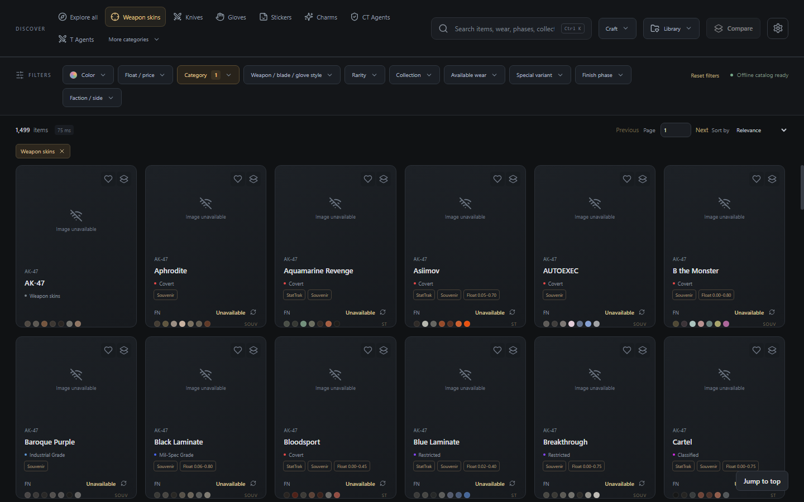
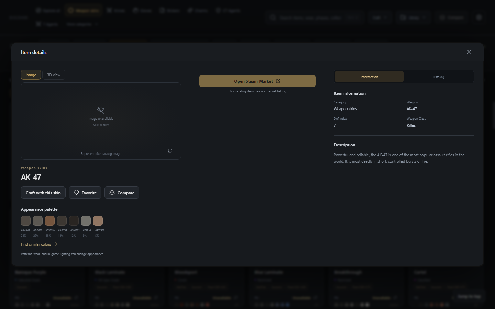
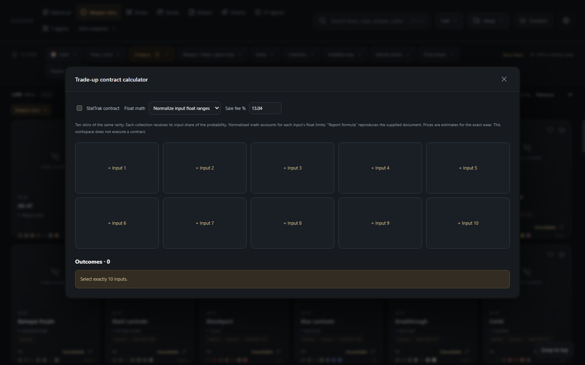
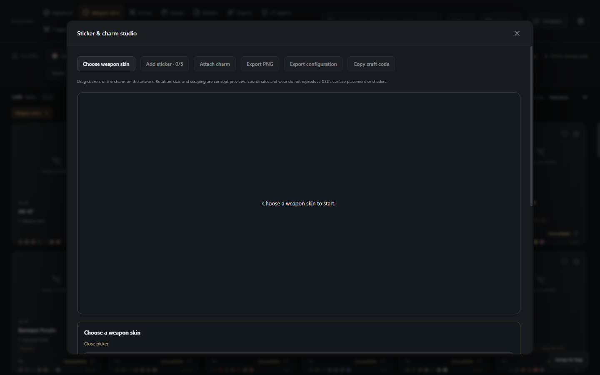
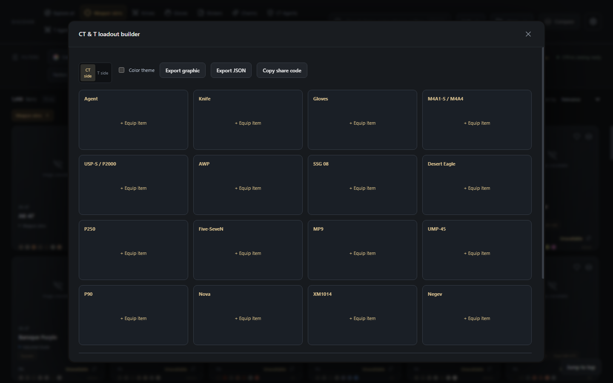

<div align="center">


# CS2 Craft

**Discover your next CS2 skin — A high-performance Windows desktop catalog, craft studio, and offline 3D inspector for Counter-Strike 2**

*Engineered with Tauri v2, Rust, React 19, SQLite, and Three.js.*

<p>
  <a href="LICENSE"></a>
  
  
  
  
  
  
  
</p>

---

<p>
  <a href="#-about-cs2-craft">About</a> • 
  <a href="#-key-features">Features</a> • 
  <a href="#-visual-tour">Visual Tour</a> • 
  <a href="#-installation--usage">Installation</a> • 
  <a href="#-building-from-source">Building</a> • 
  <a href="#-offline-3d-architecture">Offline 3D</a> • 
  <a href="#-data-sources-attribution--license">Data & Licenses</a>
</p>

<picture>
  
</picture>

</div>

---

## 🎯 About CS2 Craft

**CS2 Craft** is a personal, standalone Windows desktop catalog and companion tool designed for Counter-Strike 2 players, skin collectors, and craft planners.

Browsing cosmetics in the Steam Community Market or generic websites is often clunky, rate-limited, and disconnected from your visual vision. **CS2 Craft** combines an indexed 29,000+ item local catalog, CIEDE2000 perceptual color matching, a 10-slot trade-up math simulator, a 2D sticker and charm craft studio, a CT/T loadout organizer, and local-first offline 3D model extraction into a single, cohesive desktop application:

- 💻 **Independent Windows Application**: Native lightweight Tauri v2 shell with dedicated isolated local storage at `%LOCALAPPDATA%\com.cs2craft.catalog\`, desktop shortcuts, and zero registry clutter.
- 🛡️ **Zero Telemetry & Local-First**: No mandatory user accounts, no telemetry pings, no cloud tracking, and no subscriptions. All saves, favorites, custom lists, and activity stats stay purely on your machine in SQLite.
- ⚡ **Lightning Fast & Offline Ready**: Over 29,000 items pre-indexed with multi-field search and color signatures. Viewed images are retained in a local cache for instant offline browsing.
- 📈 **Intelligent Market Integration**: Live Steam Community Market and Skinport cash prices fetched with queue-managed rate limiting, automatic backoff recovery, multi-currency support, and price-history tracking.

---

## ✨ Key Features

<table>
  <tr>
    <td width="50%">
      <h3>🔍 Perceptual Color &amp; Multi-Field Search</h3>
      <p>Search across 29,000+ items by name, rarity, wear, phase, collection, and faction. Match up to two simultaneous colors using CIEDE2000 distance with dominant and accent modes. Filter with negative operators like <code>ak47 ft -safari</code> or <code>-wear:bs</code>.</p>
    </td>
    <td width="50%">
      <h3>🧪 Trade-Up Contract Calculator</h3>
      <p>Simulate 10-slot Trade-Up contracts from Consumer to Classified tier with exact float validation. Calculate real collection outcome odds, StatTrak support, sale fees, expected value (EV), ROI, and 1,000-outcome simulations.</p>
    </td>
  </tr>
  <tr>
    <td width="50%">
      <h3>🎨 2D Sticker &amp; Charm Craft Studio</h3>
      <p>Visualize cosmetic combinations on a responsive canvas. Place, rotate, and scale up to 5 stickers with simulated wear scraping, attach charms, track total craft cost, and share builds via portable codes.</p>
    </td>
    <td width="50%">
      <h3>🎮 Offline 3D Model Inspection</h3>
      <p>Inspect weapon models without web viewers or streaming services. Automatically reads geometry and finishes directly from your local Counter-Strike 2 VPK files with map-inspired lighting and PBR shaders.</p>
    </td>
  </tr>
  <tr>
    <td width="50%">
      <h3>🎒 Steam Public Inventory Import</h3>
      <p>Import public inventories instantly via SteamID64 or vanity profile URL. Inspect asset quantities, variant valuations, applied stickers/charms, and unpriced item badges with zero credential requirements.</p>
    </td>
    <td width="50%">
      <h3>📊 Multi-Currency Quotes &amp; Usage Trends</h3>
      <p>Streamlined pricing in 10 currencies (USD, EUR, GBP, TRY, CAD, AUD, CNY, BRL, JPY, PLN). Track 7/30/90-day price histories and discover your own browsing patterns through privacy-preserving local statistics.</p>
    </td>
  </tr>
</table>

---

## 📸 Visual Tour

### 1. Unified Cosmetics Catalog &amp; Intelligent Color Search
Explore skins, knives, gloves, agents, stickers, charms, and music kits with instant filtering, wear bounds, and CIEDE2000 dual-color matching.

<p align="center">
  
</p>

### 2. Comprehensive Item Detail &amp; Historical Price Analytics
Examine exact variant quotes, floating-point bounds, associated collections, case drop sources, and 7/30/90-day price trends side-by-side.

<p align="center">
  
</p>

### 3. Mathematical Trade-Up Contract Calculator
Model contract economics with real collection outcome odds, configurable marketplace seller fees, exact float formulas, and Monte Carlo probability simulations.

<p align="center">
  
</p>

### 4. Interactive 2D Sticker &amp; Charm Craft Canvas
Experiment with custom sticker positioning, scaling, rotation, scraping wear, and charm attachments with instant budget tracking and portable configuration codes.

<p align="center">
  
</p>

### 5. Tactical CT &amp; T Loadout Planner
Organize side-specific weapons, pistols, heavy rifles, and agent outfits. Monitor entire loadout valuation with instant missing-price alerts and export setups as JSON or share codes.

<p align="center">
  
</p>

---

## 🚀 Installation &amp; Usage

### Running the Windows Installer

Install CS2 Craft using the bundled NSIS installer:

```powershell
CS2 Craft_0.4.0_x64-setup.exe
```

Upon installation, CS2 Craft configures:
- A per-user installation (requires no administrator privileges).
- Windows Start Menu shortcuts and high-resolution desktop icons.
- An isolated application storage directory at `%LOCALAPPDATA%\com.cs2craft.catalog\`.

### Storage &amp; Cache Layout

| Content | Location | Purpose |
|---|---|---|
| **Database** | `%LOCALAPPDATA%\com.cs2craft.catalog\library.sqlite` | Favorites, custom lists, and tag memberships |
| **Market Quotes** | `%LOCALAPPDATA%\com.cs2craft.catalog\prices.sqlite` | Steam &amp; Skinport price history cache |
| **Images** | `%LOCALAPPDATA%\com.cs2craft.catalog\cache\images\` | Offline skin thumbnails and cosmetic artwork |
| **3D Models** | `%LOCALAPPDATA%\com.cs2craft.catalog\cache\models\` | Extracted GLB meshes and materials |

> [!TIP]
> Use **Settings &amp; catalog → Clear image cache** at any time to free disk space without disturbing your saved lists or favorite items.

### Keyboard Shortcuts

- <kbd>Ctrl</kbd> + <kbd>K</kbd>: Focus search dropdown instantly from anywhere in the app.
- <kbd>↑</kbd> / <kbd>↓</kbd> and <kbd>Enter</kbd>: Navigate and select search suggestions.
- <kbd>Esc</kbd>: Dismiss active dropdowns, popovers, or modal dialogs.

---

## 🛠️ Building from Source

### Prerequisites

Ensure the following tools are installed on your Windows machine:
- **Node.js** (v20+ recommended)
- **Rust toolchain** (stable MSVC, e.g. `x86_64-pc-windows-msvc`)
- **Visual Studio C++ Build Tools** (Desktop development with C++)
- **WebView2 Runtime** (pre-installed on modern Windows 10/11)
- **Counter-Strike 2** (installed via Steam; required only for local 3D model conversion)

### Build Steps

1. **Clone the repository:**
   ```powershell
   git clone https://github.com/projectGloria/CS2Craft.git
   cd CS2Craft
   ```

2. **Install frontend dependencies:**
   ```powershell
   npm ci
   ```

3. **Run desktop in development mode:**
   ```powershell
   npm run desktop
   ```

4. **Package the production NSIS installer:**
   ```powershell
   npm run package
   ```
   The generated installer will be located in:
   ```
   src-tauri/target/release/bundle/nsis/
   ```

### Additional Available Scripts

| Command | Description |
|---|---|
| `npm run dev` | Launch development-only browser preview on `http://127.0.0.1:1420` |
| `npm test` | Run frontend Vitest test suite and offline-viewer unit tests |
| `npm run test:native` | Run Rust unit &amp; integration test suite |
| `npm run catalog:prepare` | Rebuild catalog snapshot and palette index from upstream |
| `cargo run --manifest-path src-tauri/Cargo.toml --release --bin catalog-check` | Comprehensive 29,280-item offline integration verification |

---

## 🧊 Offline 3D Architecture

CS2 Craft includes a zero-cloud 3D weapon viewer:

<p align="center">
  
</p>

- **Local Steam Detection**: Automatically detects the active CS2 installation path through Steam registry keys (`Counter-Strike Global Offensive/game/csgo/pak01_dir.vpk`).
- **Source 2 Extraction Pipeline**: Uses the pinned Source 2 Viewer CLI to extract game geometry, UV layouts, normal maps, and finish masks directly into standalone `.glb` containers.
- **PBR Approximation Engine**: Renders dynamic lighting, metallic/roughness workflows, and inspect rotations in Three.js without requiring online shader streaming.
- **Cache Persistence**: Converted GLB assets are cached locally under `cache/models/` for instantaneous subsequent re-inspection.

---

## ⚖️ Data Sources, Attribution &amp; License

CS2 Craft is free, open-source software licensed under the **[MIT License](LICENSE)**.

- **Catalog Metadata**: Provided by [ByMykel/CSGO-API](https://github.com/ByMykel/CSGO-API) (MIT).
- **Artwork Tracking**: Provided by [counter-strike-image-tracker](https://github.com/ByMykel/counter-strike-image-tracker) (MIT).
- **Model Tooling**: Powered by [ValveResourceFormat / Source 2 Viewer](https://github.com/ValveResourceFormat/ValveResourceFormat).
- **Market Data**: Quotes sourced via public Steam Community Market and Skinport endpoints.
- **Legal Disclaimer**: CS2 Craft is an independent, unofficial project and is not affiliated with, endorsed by, or sponsored by Valve Corporation. Counter-Strike, CS2, Steam, and their respective logos and game artwork are registered trademarks of Valve Corporation.

---

<div align="center">
  <sub>Crafted with precision for the Counter-Strike community by projectGloria.</sub>
</div>
